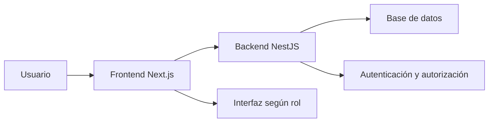

# Taller Grupal Semestral - Proyecto Full Stack


* **Categoría:** Backend + Frontend


* **Creado por:** Juan Perez


* **Propósito:** Diseñar y construir, en equipos de tres personas, una aplicación web completa que resuelva una problemática real mediante un backend en NestJS y un frontend en Next.js totalmente funcionales.


* **Modalidad:** Trabajo grupal, equipos de 3 integrantes.


* **Duración:** Desarrollo progresivo durante el semestre.


* **Entregas evaluativas:** D1, D2, D3 y DF.


* **Peso total en la nota del curso:** 40%.


* **Fechas:** Serán informadas posteriormente.


---

## Tabla de Contenidos

1. [Descripción General](https://www.google.com/search?q=%231-descripci%C3%B3n-general)
2. [Resultados de Aprendizaje Integrados](https://www.google.com/search?q=%232-resultados-de-aprendizaje-integrados)
3. [Alcance Mínimo del Producto](https://www.google.com/search?q=%233-alcance-m%C3%ADnimo-del-producto)
* [3.1 Problemática y usuarios](https://www.google.com/search?q=%2331-problem%C3%A1tica-y-usuarios)
* [3.2 Tres funcionalidades principales](https://www.google.com/search?q=%2332-tres-funcionalidades-principales)
* [3.3 Autenticación y autorización obligatorias](https://www.google.com/search?q=%2333-autenticaci%C3%B3n-y-autorizaci%C3%B3n-obligatorias)


4. [Tecnologías y Contenidos que Debe Integrar](https://www.google.com/search?q=%234-tecnolog%C3%ADas-y-contenidos-que-debe-integrar)
5. [Organización del Equipo](https://www.google.com/search?q=%235-organizaci%C3%B3n-del-equipo)
* [Responsabilidades](https://www.google.com/search?q=%23responsabilidades)
* [Evidencia de organización](https://www.google.com/search?q=%23evidencia-de-organizaci%C3%B3n)


6. [Entregas y Peso en la Nota del Curso](https://www.google.com/search?q=%236-entregas-y-peso-en-la-nota-del-curso)
7. [D1 - Definición y Diseño del Proyecto](https://www.google.com/search?q=%237-d1---definici%C3%B3n-y-dise%C3%B1o-del-proyecto)
* [7.1 Problemática](https://www.google.com/search?q=%2371-problem%C3%A1tica)
* [7.2 Requerimientos](https://www.google.com/search?q=%2372-requerimientos)
* [7.3 Funcionalidades principales](https://www.google.com/search?q=%2373-funcionalidades-principales)
* [7.4 Diseño de base de datos](https://www.google.com/search?q=%2374-dise%C3%B1o-de-base-de-datos)
* [7.5 Diseño en Figma](https://www.google.com/search?q=%2375-dise%C3%B1o-en-figma)
* [7.6 Arquitectura inicial](https://www.google.com/search?q=%2376-arquitectura-inicial)
* [7.7 Planning](https://www.google.com/search?q=%2377-planning)
* [7.8 Presentación y sustentación](https://www.google.com/search?q=%2378-presentaci%C3%B3n-y-sustentaci%C3%B3n)
* [Lista de verificación D1](https://www.google.com/search?q=%23lista-de-verificaci%C3%B3n-d1)


8. [D2 - Backend Terminado y Avance Visual](https://www.google.com/search?q=%238-d2---backend-terminado-y-avance-visual)
* [Backend requerido](https://www.google.com/search?q=%23backend-requerido)
* [Docker](https://www.google.com/search?q=%23docker)
* [Avance de frontend](https://www.google.com/search?q=%23avance-de-frontend)
* [Documentación](https://www.google.com/search?q=%23documentaci%C3%B3n)
* [Presentación y sustentación](https://www.google.com/search?q=%23presentaci%C3%B3n-y-sustentaci%C3%B3n-1)
* [Lista de verificación D2](https://www.google.com/search?q=%23lista-de-verificaci%C3%B3n-d2)


9. [D3 - Frontend Conectado al Backend](https://www.google.com/search?q=%239-d3---frontend-conectado-al-backend)
* [Elementos requeridos](https://www.google.com/search?q=%23elementos-requeridos)
* [Evidencias](https://www.google.com/search?q=%23evidencias)
* [Presentación y sustentación](https://www.google.com/search?q=%23presentaci%C3%B3n-y-sustentaci%C3%B3n-2)
* [Lista de verificación D3](https://www.google.com/search?q=%23lista-de-verificaci%C3%B3n-d3)


10. [DF - Entrega Final](https://www.google.com/search?q=%2310-df---entrega-final)
* [Funcionalidad](https://www.google.com/search?q=%23funcionalidad)
* [Frontend](https://www.google.com/search?q=%23frontend)
* [Backend](https://www.google.com/search?q=%23backend)
* [Pruebas y calidad](https://www.google.com/search?q=%23pruebas-y-calidad)
* [Seguridad](https://www.google.com/search?q=%23seguridad)
* [Infraestructura y despliegue](https://www.google.com/search?q=%23infraestructura-y-despliegue)
* [Documentación final](https://www.google.com/search?q=%23documentaci%C3%B3n-final)
* [Presentación y sustentación](https://www.google.com/search?q=%23presentaci%C3%B3n-y-sustentaci%C3%B3n-3)
* [Lista de verificación DF](https://www.google.com/search?q=%23lista-de-verificaci%C3%B3n-df)


11. [Sustentación Oral](https://www.google.com/search?q=%2311-sustentaci%C3%B3n-oral)
12. [Política de Uso de Inteligencia Artificial](https://www.google.com/search?q=%2312-pol%C3%ADtica-de-uso-de-inteligencia-artificial)
* [Usos permitidos como apoyo](https://www.google.com/search?q=%23usos-permitidos-como-apoyo)
* [Condiciones](https://www.google.com/search?q=%23condiciones)
* [Usos no aceptables](https://www.google.com/search?q=%23usos-no-aceptables)
* [Registro obligatorio](https://www.google.com/search?q=%23registro-obligatorio)


13. [Repositorio y Evidencia de Trabajo](https://www.google.com/search?q=%2313-repositorio-y-evidencia-de-trabajo)
14. [Criterios Generales de Evaluación](https://www.google.com/search?q=%2314-criterios-generales-de-evaluaci%C3%B3n)
15. [Condiciones de Aprobación de la Propuesta](https://www.google.com/search?q=%2315-condiciones-de-aprobaci%C3%B3n-de-la-propuesta)
16. [Ejemplos de Problemáticas](https://www.google.com/search?q=%2316-ejemplos-de-problem%C3%A1ticas)
17. [Definición Final de Terminado](https://www.google.com/search?q=%2317-definici%C3%B3n-final-de-terminado)

---

## 1. Descripción General

Cada equipo identificará una problemática real o verificable que afecte a un grupo de usuarios definido[cite: 4]. A partir de ella diseñará e implementará una solución web completa[cite: 4].

El proyecto no debe comenzar con la pregunta «¿qué aplicación queremos programar?», sino con estas preguntas[cite: 4]:

1. ¿Qué problema existe?[cite: 4]
2. ¿Quién experimenta ese problema?[cite: 4]
3. ¿Cómo se resuelve actualmente?[cite: 4]
4. ¿Qué limitaciones tiene la solución actual?[cite: 4]
5. ¿Qué cambio concreto producirá la aplicación?[cite: 4]

El resultado final debe funcionar de principio a fin[cite: 4]:



> **Nota:** No se evaluará solamente la cantidad de código[cite: 4]. Se evaluará que la solución responda al problema planteado y que cada integrante pueda explicar qué construyó, dónde lo construyó, cómo funciona y por qué tomó esas decisiones[cite: 4].

---

## 2. Resultados de Aprendizaje Integrados

El proyecto permite demostrar que el equipo puede[cite: 4]:

* Seleccionar y justificar una arquitectura, herramientas y frameworks adecuados[cite: 4].
* Diseñar y desarrollar interfaces web considerando usabilidad y experiencia de usuario[cite: 5].
* Construir servicios backend con persistencia de datos[cite: 5].
* Integrar pruebas automatizadas en backend y frontend[cite: 5].
* Conectar todas las capas de una aplicación y desplegar un producto funcional[cite: 5].

---

## 3. Alcance Mínimo del Producto

### 3.1 Problemática y usuarios

La propuesta debe[cite: 5]:

* Describir una situación concreta, no solamente un sector o una idea general[cite: 5].
* Identificar usuarios o actores reales[cite: 5].
* Explicar el impacto o dificultad causada por el problema[cite: 5].
* Delimitar qué resolverá la aplicación y qué quedará por fuera[cite: 5].
* Presentar evidencia razonable de la necesidad: observación, entrevista, experiencia directa, fuentes o análisis del proceso actual[cite: 5].

### 3.2 Tres funcionalidades principales

Cada solución debe incluir al menos tres funcionalidades principales de negocio[cite: 5]. Una funcionalidad principal[cite: 5]:

* Resuelve una necesidad completa de un usuario[cite: 5].
* Incluye flujo de interfaz, reglas de negocio, endpoints y persistencia[cite: 5].
* Produce un resultado observable[cite: 5].
* Puede demostrarse de principio a fin[cite: 5].

*Ejemplo:* En un sistema de citas, «gestionar una cita» puede incluir consultar disponibilidad, reservar, reprogramar y cancelar[cite: 5]. Cada operación CRUD no cuenta como una funcionalidad principal diferente[cite: 5].

> **¡Atención!** Una pantalla, una tabla, un botón o un endpoint aislado no constituyen por sí solos una funcionalidad principal[cite: 6].

### 3.3 Autenticación y autorización obligatorias

Todos los proyectos deben implementar *user authentication and authorization*[cite: 6].

* **Autenticación:** permite comprobar quién es el usuario[cite: 6].
* **Autorización:** determina qué acciones puede realizar ese usuario[cite: 6].

Requisitos mínimos[cite: 6]:

* Inicio de sesión seguro[cite: 6].
* Al menos dos roles o tipos de usuario con permisos diferentes[cite: 6].
* Contraseñas protegidas mediante hash; nunca almacenadas en texto plano[cite: 6].
* Emisión y validación de JWT mediante Passport en NestJS[cite: 6].
* Guards para proteger rutas y operaciones[cite: 6].
* Verificación de permisos en el backend[cite: 6].
* Flujo de sesión integrado en el frontend[cite: 6].
* Navegación y acciones adaptadas al rol[cite: 6].
* Manejo adecuado de acceso no autorizado y sesión expirada[cite: 6].

> **Importante:** Ocultar un botón en el frontend no es autorización[cite: 6]. El backend debe comprobar los permisos antes de ejecutar una operación[cite: 6].

La autenticación y autorización son requisitos transversales y no reemplazan ninguna de las tres funcionalidades principales de negocio[cite: 6].

---

## 4. Tecnologías y Contenidos que Debe Integrar

| Área | Aplicación esperada |
| --- | --- |
| **Docker** | Entorno reproducible mediante `Dockerfile` y `Docker Compose`.[cite: 7] |
| **Backend** | NestJS organizado en módulos, controllers, services y providers.[cite: 7] |
| **Persistencia** | Base de datos relacional conectada mediante TypeORM, con entidades, relaciones y repositorios.[cite: 7] |
| **API** | DTO, pipes, validators, manejo de errores, interceptors y colección de Postman.[cite: 7] |
| **Seguridad backend** | JWT, Passport, guards, roles y permisos.[cite: 7] |
| **Pruebas backend** | Pruebas de servicios y pruebas de integración.[cite: 7] |
| **Frontend** | React y Next.js con páginas, rutas estáticas y dinámicas, componentes y hooks.[cite: 7] |
| **Estado** | Zustand cuando exista estado compartido que lo justifique.[cite: 7] |
| **Integración** | Consumo funcional del backend, autenticación, autorización y manejo de estados de interfaz.[cite: 7] |
| **Calidad frontend** | Seguridad, pruebas E2E y optimización en Next.js.[cite: 7] |
| **Despliegue** | Frontend, backend y base de datos accesibles en ambientes desplegados.[cite: 7] |
| **Automatización** | Flujo básico de CI/CD para verificar calidad, pruebas o compilación.[cite: 7] |

---

## 5. Organización del Equipo

Cada equipo estará compuesto por tres personas[cite: 7].

### Responsabilidades

* Cada integrante liderará al menos una de las tres funcionalidades principales[cite: 8]. Liderar una funcionalidad no significa ser su único responsable[cite: 8].
* Todos deben comprender la arquitectura, la base de datos, la autenticación y el recorrido completo de las funcionalidades[cite: 8].
* Las tareas deben distribuirse de manera verificable[cite: 8].
* El historial del repositorio debe permitir reconocer las contribuciones individuales[cite: 8].
* El equipo debe revisar e integrar el trabajo de sus integrantes[cite: 8].

> **El objetivo no es construir tres proyectos separados y unirlos al final[cite: 8]. Las tres personas deben desarrollar un solo producto coherente[cite: 8].**

### Evidencia de organización

El equipo deberá mantener durante el semestre[cite: 8]:

* Repositorio compartido[cite: 8].
* Tablero de tareas[cite: 8].
* Responsables por tarea[cite: 8].
* Fechas de inicio y finalización[cite: 8].
* Estado de cada tarea[cite: 8].
* Hitos de cada entrega[cite: 8].
* Registro de decisiones importantes[cite: 8].
* Commits identificables por integrante[cite: 8].

*No se considera evidencia suficiente dividir el proyecto únicamente en «backend», «frontend» y «documentación»[cite: 8]. La asignación debe mostrar funcionalidades y tareas concretas[cite: 8].*

---

## 6. Entregas y Peso en la Nota del Curso

| Entrega | Peso en la nota final | Estado esperado del proyecto |
| --- | --- | --- |
| **D1 - Definición y diseño** | 5% | Problema, alcance, requerimientos, datos, experiencia y planificación definidos.[cite: 9] |
| **D2 - Backend funcional** | 10% | Backend terminado y primeras pantallas del frontend.[cite: 9] |
| **D3 - Integración frontend** | 10% | Frontend avanzado, conectado al backend y con flujos funcionales.[cite: 9] |
| **DF - Producto final** | 15% | Aplicación completa, probada, segura, optimizada, documentada y desplegada.[cite: 9] |

> **Nota:** Las entregas son acumulativas[cite: 9]. Una entrega posterior debe conservar, corregir y mejorar lo presentado anteriormente[cite: 9].

---

## 7. D1 - Definición y Diseño del Proyecto

* **Peso en la nota final del curso:** 5%[cite: 9]
* **Objetivo:** Demostrar que el proyecto parte de un problema comprensible, tiene un alcance viable y cuenta con una ruta de trabajo[cite: 9].

### Elementos requeridos

#### 7.1 Problemática

* Descripción del problema[cite: 9].
* Usuarios afectados[cite: 9].
* Proceso o solución actual[cite: 9].
* Consecuencias del problema[cite: 9].
* Evidencia que respalde su existencia[cite: 9].
* Alcance y límites de la solución propuesta[cite: 10].

#### 7.2 Requerimientos

* Objetivo general del producto[cite: 10].
* Requerimientos funcionales[cite: 10].
* Requerimientos no funcionales[cite: 10].
* Historias de usuario o casos de uso[cite: 10].
* Criterios de aceptación[cite: 10].
* Actores, roles y permisos[cite: 10].
* Matriz de trazabilidad entre problema, requerimientos y funcionalidades[cite: 10].

#### 7.3 Funcionalidades principales

Definición de al menos tres funcionalidades principales[cite: 10]. Para cada una se debe indicar[cite: 10]:

* Usuario beneficiado[cite: 10].
* Necesidad que resuelve[cite: 10].
* Flujo principal[cite: 10].
* Reglas de negocio[cite: 10].
* Información que utiliza o produce[cite: 10].
* Criterio que permitirá demostrar que funciona[cite: 10].

#### 7.4 Diseño de base de datos

* Diagrama entidad-relación[cite: 10].
* Entidades, atributos y tipos de datos principales[cite: 10].
* Claves primarias y foráneas[cite: 10].
* Relaciones y cardinalidades[cite: 10].
* Restricciones relevantes[cite: 10].
* Diccionario de datos inicial[cite: 10].
* Explicación de cómo el modelo soporta las tres funcionalidades y los usuarios[cite: 10].

#### 7.5 Diseño en Figma

El prototipo debe incluir[cite: 11]:

* Flujo de autenticación[cite: 11].
* Navegación principal[cite: 11].
* Pantallas esenciales de las tres funcionalidades[cite: 11].
* Estados importantes: vacío, error, carga y confirmación[cite: 11].
* Diferencias visibles entre roles cuando aplique[cite: 11].
* Coherencia entre pantallas y requerimientos[cite: 11].

#### 7.6 Arquitectura inicial

* Diagrama de frontend, backend, base de datos y servicios externos[cite: 11].
* Stack tecnológico[cite: 11].
* Organización preliminar de módulos del backend[cite: 11].
* Rutas principales del frontend[cite: 11].
* Decisiones técnicas iniciales y su justificación[cite: 11].

#### 7.7 Planning

* Hitos de las cuatro entregas[cite: 11].
* Tareas concretas[cite: 11].
* Fechas planeadas por el equipo[cite: 11].
* Responsable principal de cada tarea[cite: 11].
* Dependencias entre tareas[cite: 11].
* Riesgos iniciales y acciones de mitigación[cite: 11].
* Herramienta utilizada para el seguimiento[cite: 11].

#### 7.8 Presentación y sustentación

El equipo presentará[cite: 11]:

* La problemática[cite: 11].
* La propuesta de solución[cite: 11].
* Los usuarios[cite: 11].
* Las tres funcionalidades[cite: 11].
* El modelo de datos[cite: 12].
* El prototipo[cite: 12].
* La arquitectura[cite: 12].
* El plan de trabajo[cite: 12].

*Todos los integrantes deberán responder preguntas sobre la propuesta completa[cite: 12].*

### Lista de verificación D1

* [ ] La problemática es concreta y está sustentada[cite: 12].
* [ ] La solución tiene un alcance viable[cite: 12].
* [ ] Existen al menos tres funcionalidades principales de negocio[cite: 12].
* [ ] Autenticación, roles y permisos están definidos[cite: 12].
* [ ] Los requerimientos tienen criterios de aceptación[cite: 12].
* [ ] El modelo de datos soporta los requerimientos[cite: 12].
* [ ] El prototipo permite comprender los flujos principales[cite: 12].
* [ ] El planning contiene tareas, responsables y fechas[cite: 12].
* [ ] El equipo puede defender sus decisiones[cite: 12].

---

## 8. D2 - Backend Terminado y Avance Visual

* **Peso en la nota final del curso:** 10%[cite: 12]
* **Objetivo:** Demostrar un backend funcional, seguro, persistente y probado, junto con una primera implementación visual del frontend[cite: 12].

### Backend requerido

* Proyecto NestJS organizado por módulos funcionales[cite: 12].
* Controllers dedicados a recibir y responder peticiones[cite: 12].
* Services con operaciones y reglas de negocio[cite: 12].
* Providers e inyección de dependencias utilizados correctamente[cite: 13].
* Base de datos conectada mediante TypeORM[cite: 13].
* Entidades y relaciones consistentes con el diseño aprobado[cite: 13].
* Repositorios y operaciones CRUD necesarias[cite: 13].
* DTO, pipes y validators para los datos de entrada[cite: 13].
* Manejo consistente de errores y respuestas[cite: 13].
* Interceptor aplicado a una necesidad justificada, por ejemplo logging[cite: 13].
* Autenticación con JWT y Passport[cite: 13].
* Guards y autorización por roles o permisos[cite: 13].
* Endpoints necesarios para las tres funcionalidades principales[cite: 13].
* Pruebas de servicios[cite: 13].
* Pruebas de integración sobre flujos importantes[cite: 13].
* Colección de Postman organizada y ejecutable[cite: 13].
* Variables de entorno documentadas en `.env.example`[cite: 13].
* Base de datos reproducible mediante migraciones o scripts versionados[cite: 13].
* Backend desplegado y accesible para demostración[cite: 13].

### Docker

* `Dockerfile` funcional para el backend[cite: 13].
* `Docker Compose` para ejecutar los servicios necesarios en desarrollo[cite: 13].
* Instrucciones para levantar el entorno[cite: 13].
* Ningún secreto incluido en la imagen o el repositorio[cite: 13].

### Avance de frontend

* Proyecto Next.js creado y organizado[cite: 13].
* Estructura inicial de rutas[cite: 13].
* Layout, navegación y estilos base[cite: 13].
* Pantallas de autenticación[cite: 13].
* Pantalla principal o dashboard[cite: 13].
* Al menos una pantalla representativa de una funcionalidad[cite: 13].
* Correspondencia visible con el prototipo de Figma[cite: 13].

*En esta entrega las pantallas pueden utilizar datos temporales si la integración correspondiente todavía no está terminada[cite: 14].*

### Documentación

* `README` actualizado[cite: 14].
* Diagrama de arquitectura actualizado[cite: 14].
* Modelo de base de datos actualizado[cite: 14].
* Instrucciones de instalación y ejecución[cite: 14].
* URL del backend desplegado[cite: 14].
* Credenciales de demostración para los roles definidos[cite: 14].

### Presentación y sustentación

El equipo deberá demostrar la API funcionando, recorrer la arquitectura y explicar decisiones de módulos, servicios, persistencia, autenticación, autorización y pruebas[cite: 14].
Cada integrante deberá ubicar y explicar en el código las partes sobre las que sea consultado[cite: 14].

### Lista de verificación D2

* [ ] Las tres funcionalidades cuentan con soporte funcional en el backend[cite: 14].
* [ ] Los datos se almacenan en una base de datos[cite: 14].
* [ ] La autenticación funciona[cite: 14].
* [ ] La autorización se verifica en el backend[cite: 14].
* [ ] Los datos de entrada se validan[cite: 14].
* [ ] Existen pruebas automatizadas relevantes[cite: 14].
* [ ] La colección de Postman permite comprobar los flujos[cite: 14].
* [ ] Docker permite reproducir el entorno[cite: 14].
* [ ] El backend está desplegado[cite: 14].
* [ ] Existe un avance verificable del frontend[cite: 14].

---

## 9. D3 - Frontend Conectado al Backend

* **Peso en la nota final del curso:** 10%[cite: 15]
* **Objetivo:** Demostrar que el frontend consume el backend y permite ejecutar flujos reales del producto[cite: 15].

### Elementos requeridos

* Páginas estáticas y dinámicas implementadas con Next.js según la necesidad[cite: 15].
* Componentes reutilizables[cite: 15].
* Navegación coherente[cite: 15].
* Formularios conectados con la API[cite: 15].
* Inicio y cierre de sesión integrados[cite: 15].
* Sesión del usuario utilizada en las peticiones[cite: 15].
* Interfaz y navegación adaptadas según el rol[cite: 15].
* Rutas o pantallas protegidas[cite: 15].
* Manejo de respuestas no autorizadas[cite: 15].
* Uso adecuado de hooks[cite: 15].
* Al menos un hook personalizado para una necesidad reutilizable[cite: 15].
* Estados visibles de carga, error, vacío y éxito[cite: 15].
* Tratamiento de errores provenientes del backend[cite: 15].
* Diseño responsivo[cite: 15].
* Backend desplegado y estable para la integración[cite: 15].

**Como avance mínimo:**

* Al menos dos de las tres funcionalidades principales deben poder demostrarse de principio a fin[cite: 15].
* La funcionalidad restante debe contar con sus pantallas principales y un plan claro de integración[cite: 15].
* La autenticación y autorización deben funcionar de extremo a extremo[cite: 15].

### Evidencias

* Aplicación ejecutable[cite: 16].
* URL o ambiente de demostración[cite: 16].
* Casos de prueba manuales[cite: 16].
* Planning actualizado[cite: 16].
* Figma actualizado si el diseño cambió[cite: 16].
* README con instrucciones de integración[cite: 16].
* Registro de problemas encontrados y decisiones tomadas[cite: 16].

### Presentación y sustentación

El equipo demostrará los flujos desde la interfaz hasta la base de datos[cite: 16]. Las respuestas deberán explicar cómo viajan los datos, cómo se maneja la sesión, dónde se aplican los permisos y cómo se tratan los errores[cite: 16].

### Lista de verificación D3

* [ ] El frontend consume el backend real[cite: 16].
* [ ] El usuario puede iniciar y cerrar sesión[cite: 16].
* [ ] Los permisos afectan la experiencia y son validados por el backend[cite: 16].
* [ ] Dos funcionalidades principales operan de extremo a extremo[cite: 16].
* [ ] Los estados de interfaz están implementados[cite: 16].
* [ ] La navegación y el diseño son coherentes[cite: 16].
* [ ] El equipo puede seguir una acción desde la pantalla hasta la base de datos[cite: 16].

---

## 10. DF - Entrega Final

* **Peso en la nota final del curso:** 15%[cite: 16]
* **Objetivo:** Presentar una aplicación completa, estable y desplegada que resuelva la problemática definida[cite: 16, 17].

### Funcionalidad

* Las tres funcionalidades principales operan de extremo a extremo[cite: 17].
* Los flujos definidos en los requerimientos están implementados[cite: 17].
* La autenticación y autorización funcionan para todos los roles[cite: 17].
* Las reglas de negocio están aplicadas[cite: 17].
* Los datos persisten correctamente[cite: 17].
* Los errores se presentan de manera comprensible[cite: 17].
* No existen pantallas o botones esenciales sin funcionamiento[cite: 17].

### Frontend

* Aplicación desarrollada con Next.js[cite: 17].
* Rutas estáticas y dinámicas aplicadas donde corresponda[cite: 17].
* Componentes reutilizables[cite: 17].
* Hooks y hooks personalizados utilizados con intención[cite: 17].
* Zustand utilizado para el estado compartido que lo requiera[cite: 17].
* Diseño responsivo y coherente con Figma[cite: 17].
* Estados de carga, error, vacío y éxito[cite: 17].
* Integración segura con el backend[cite: 17].
* Optimización de recursos y solicitudes[cite: 17].
* Manejo justificado de timeouts, hidratación o rehidratación cuando aplique[cite: 17].

### Backend

* Arquitectura modular en NestJS[cite: 17].
* Services, controllers, providers e inyección de dependencias[cite: 17].
* TypeORM con entidades, relaciones y repositorios[cite: 17].
* DTO, validators y pipes[cite: 17].
* Interceptors aplicados con una finalidad clara[cite: 17].
* JWT, Passport, guards y permisos[cite: 18].
* Manejo centralizado y consistente de errores[cite: 18].
* Configuración mediante variables de entorno[cite: 18].

### Pruebas y calidad

* Pruebas de servicios[cite: 18].
* Pruebas de integración del backend[cite: 18].
* Pruebas E2E con Cypress o Playwright sobre los flujos críticos[cite: 18].
* Colección de Postman actualizada[cite: 18].
* Comandos de lint, pruebas y build funcionando[cite: 18].
* Datos de demostración reproducibles[cite: 18].

### Seguridad

* Contraseñas almacenadas de forma segura[cite: 18].
* Secretos fuera del repositorio[cite: 18].
* Autorización comprobada en el backend[cite: 18].
* Datos de entrada validados[cite: 18].
* Manejo consciente del token y la sesión en el frontend[cite: 18].
* No exposición innecesaria de información sensible[cite: 18].
* Dependencias y configuraciones revisadas[cite: 18].

### Infraestructura y despliegue

* `Dockerfile` y `Docker Compose` funcionales[cite: 18].
* Frontend desplegado[cite: 18].
* Backend desplegado[cite: 18].
* Base de datos desplegada[cite: 18].
* URLs accesibles[cite: 18].
* Variables de entorno configuradas de forma segura[cite: 18].
* Flujo básico de CI/CD para validar o desplegar el producto[cite: 18].

### Documentación final

* `README` completo[cite: 19].
* Descripción de la problemática y la solución[cite: 19].
* Arquitectura final[cite: 19].
* Diagrama y diccionario de datos actualizados[cite: 19].
* Instrucciones de instalación local[cite: 19].
* Instrucciones de ejecución con Docker[cite: 19].
* Variables de entorno necesarias[cite: 19].
* URLs desplegadas[cite: 19].
* Usuarios de demostración para cada rol[cite: 19].
* Colección de Postman[cite: 19].
* Estrategia y resultados de pruebas[cite: 19].
* Limitaciones conocidas[cite: 19].
* Declaración de uso de IA[cite: 19].

### Presentación y sustentación

La presentación final debe mostrar[cite: 19]:

* El problema y el valor de la solución[cite: 19].
* Un recorrido funcional de las tres funcionalidades[cite: 19].
* Autenticación y diferencias entre roles[cite: 19].
* Persistencia real[cite: 19].
* Pruebas[cite: 19].
* Arquitectura[cite: 19].
* Aplicación desplegada[cite: 19].
* Evolución frente a la propuesta inicial[cite: 19].

*Durante la sustentación se podrá solicitar a cualquier integrante que explique una decisión, ubique una implementación, siga el recorrido de una petición, interprete una entidad o prueba, diagnostique un error o realice un cambio pequeño[cite: 19].*

### Lista de verificación DF

* [ ] Las tres funcionalidades funcionan de principio a fin[cite: 20].
* [ ] Autenticación y autorización están completas[cite: 20].
* [ ] Frontend, backend y base de datos están desplegados[cite: 20].
* [ ] Docker permite reproducir el entorno[cite: 20].
* [ ] Las pruebas automatizadas cubren flujos importantes[cite: 20].
* [ ] La aplicación es usable y responsiva[cite: 20].
* [ ] No existen secretos en el repositorio[cite: 20].
* [ ] La documentación permite ejecutar y evaluar el proyecto[cite: 20].
* [ ] El uso de IA está declarado[cite: 20].
* [ ] Los tres integrantes dominan el producto[cite: 20].

---

## 11. Sustentación Oral

La sustentación oral tendrá el mayor peso en la evaluación de cada entrega[cite: 20]. La rúbrica específica y su distribución se publicarán junto con cada entrega[cite: 20].

**El producto es grupal, pero la comprensión se evalúa individualmente[cite: 20].**

Durante la sustentación[cite: 20]:

* Todos los integrantes deben participar[cite: 20].
* Las preguntas pueden referirse a cualquier parte del proyecto[cite: 20].
* Cada persona debe explicar qué hizo y señalar dónde se encuentra[cite: 20].
* Cada persona debe comprender cómo su trabajo se integra con el resto[cite: 20].
* Se deben justificar decisiones técnicas y de producto[cite: 20].
* Se puede solicitar seguir un dato desde la interfaz hasta la base de datos[cite: 20].
* Se puede solicitar interpretar código, una consulta, una prueba o una configuración[cite: 20].
* Se puede solicitar diagnosticar un error o efectuar una modificación pequeña[cite: 20].

> Las respuestas deben apoyarse en el proyecto real, no solamente en diapositivas[cite: 21].
> La calificación de los integrantes puede ser diferente aunque compartan el mismo producto[cite: 21]. Entregar código funcional no reemplaza la capacidad de explicarlo[cite: 21].

---

## 12. Política de Uso de Inteligencia Artificial

Se permite utilizar herramientas de inteligencia artificial como apoyo durante el proyecto[cite: 21]. Su uso no puede sustituir la autoría, el criterio ni la comprensión del equipo[cite: 21].

### Usos permitidos como apoyo

* Explorar alternativas durante la planeación[cite: 21].
* Revisar redacción de requerimientos y documentación[cite: 21].
* Solicitar explicaciones de conceptos[cite: 21].
* Comparar posibles soluciones técnicas[cite: 21].
* Recibir sugerencias para depurar un error[cite: 21].
* Proponer casos de prueba que el equipo deberá revisar[cite: 21].
* Revisar claridad, estilo o accesibilidad[cite: 21].
* Generar borradores que luego sean evaluados y transformados por el equipo[cite: 21].

### Condiciones

* Todo uso relevante debe declararse[cite: 21].
* El equipo debe especificar la herramienta utilizada[cite: 21].
* Debe indicarse en qué tarea se utilizó y con qué propósito[cite: 21].
* Debe explicarse qué parte de la respuesta se conservó, modificó o descartó[cite: 21].
* Todo resultado debe ser revisado, probado y adaptado[cite: 21].
* Cada integrante debe poder explicar cualquier contenido entregado[cite: 21].
* La IA no puede realizar la totalidad del producto ni reemplazar el trabajo del equipo[cite: 22].
* No deben compartirse contraseñas, tokens, secretos ni información sensible con una herramienta de IA[cite: 22].

### Usos no aceptables

* Entregar código generado que nadie comprende[cite: 22].
* Ocultar el uso de IA[cite: 22].
* Copiar una solución completa sin revisarla ni adaptarla[cite: 22].
* Utilizar IA para responder durante una sustentación[cite: 22].
* Presentar como evidencia personal trabajo realizado completamente por otra persona o herramienta[cite: 22].

*El código o contenido que no pueda ser explicado, justificado o modificado por el equipo puede no considerarse evidencia válida de aprendizaje[cite: 22].*

### Registro obligatorio

El repositorio deberá incluir un archivo `AI_USAGE.md` o una sección equivalente con este formato[cite: 22]:

```markdown
## Registro de uso de IA
- Integrante: 
- Herramienta: 
- Tarea:
- Propósito: 
- Descripción de la consulta o prompt: 
- Resultado utilizado:
- Cambios realizados por el equipo: 
- Forma de verificación:
```[cite: 22]

---

## 13. Repositorio y Evidencia de Trabajo

El repositorio debe contener[cite: 22]:
* Código del frontend y backend[cite: 22].
* Historial de commits legible[cite: 22].
* README[cite: 22].
* `.env.example` sin secretos[cite: 22].
* Instrucciones de Docker[cite: 23].
* Scripts o migraciones de base de datos[cite: 23].
* Colección de Postman[cite: 23].
* Pruebas automatizadas[cite: 23].
* Documentación técnica[cite: 23].
* Registro de uso de IA[cite: 23].

**Se espera:**
* Commits frecuentes y descriptivos[cite: 23].
* Contribuciones identificables de los tres integrantes[cite: 23].
* Uso de ramas o pull requests para integrar cambios relevantes[cite: 23].
* Tareas relacionadas con commits o entregables[cite: 23].
* Ausencia de archivos sensibles[cite: 23].

**No son buenas evidencias:**
* Un único commit con todo el proyecto[cite: 23].
* Commits realizados desde una sola cuenta para todo el equipo[cite: 23].
* Código agregado únicamente minutos antes de la entrega[cite: 23].
* Archivos sin relación con las tareas registradas[cite: 23].

---

## 14. Criterios Generales de Evaluación

Las rúbricas específicas se publicarán para cada entrega[cite: 23]. En todas se considerarán[cite: 23]:

| Criterio | Qué se observará |
| :--- | :--- |
| **Sustentación oral** | Comprensión, claridad, ubicación del trabajo, justificación y capacidad de responder o modificar.[cite: 24] |
| **Solución del problema** | Coherencia entre necesidad, usuarios, alcance y funcionalidades.[cite: 24] |
| **Diseño** | Requerimientos, experiencia, arquitectura y modelo de datos.[cite: 24] |
| **Backend** | API, persistencia, reglas, organización, seguridad y pruebas.[cite: 24] |
| **Frontend** | Usabilidad, navegación, estado, integración, seguridad y calidad.[cite: 24] |
| **Autenticación y autorización** | Identidad, roles, permisos y protección real de operaciones.[cite: 24] |
| **Calidad** | Pruebas, errores, seguridad, rendimiento y mantenibilidad.[cite: 24] |
| **Gestión del proyecto** | Planning, seguimiento, contribución y cumplimiento progresivo.[cite: 24] |
| **Producto desplegado** | Funcionamiento integral en un ambiente accesible.[cite: 24] |
| **Uso responsable de IA** | Transparencia, revisión, adaptación, verificación y comprensión.[cite: 24] |

---

## 15. Condiciones de Aprobación de la Propuesta

Una propuesta puede requerir ajustes si[cite: 24]:
* Es solamente un CRUD sin una problemática clara[cite: 24].
* Sus tres funcionalidades son en realidad pantallas u operaciones aisladas[cite: 24].
* El alcance es demasiado pequeño para tres personas[cite: 24].
* El alcance es imposible de completar durante el semestre[cite: 25].
* Copia directamente un tutorial o producto existente sin adaptación[cite: 25].
* No identifica usuarios ni valor concreto[cite: 25].
* No permite aplicar autenticación y autorización de manera significativa[cite: 25].
* Depende de servicios, datos o permisos que el equipo no puede obtener[cite: 25].

> **Nota:** El proyecto debe ser aprobado a partir de D1[cite: 25]. Los cambios posteriores de alcance deberán ser justificados y autorizados.

---

## 16. Ejemplos de Problemáticas

*(Sección correspondiente a la estructura del documento)*

---

## 17. Definición Final de Terminado

*(Sección correspondiente a la estructura del documento)*

```