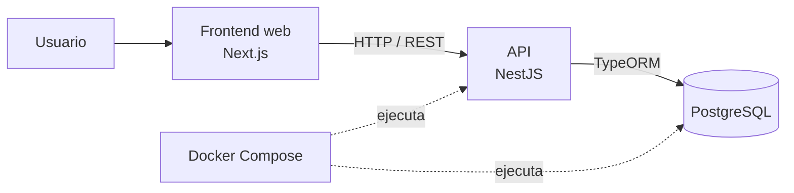
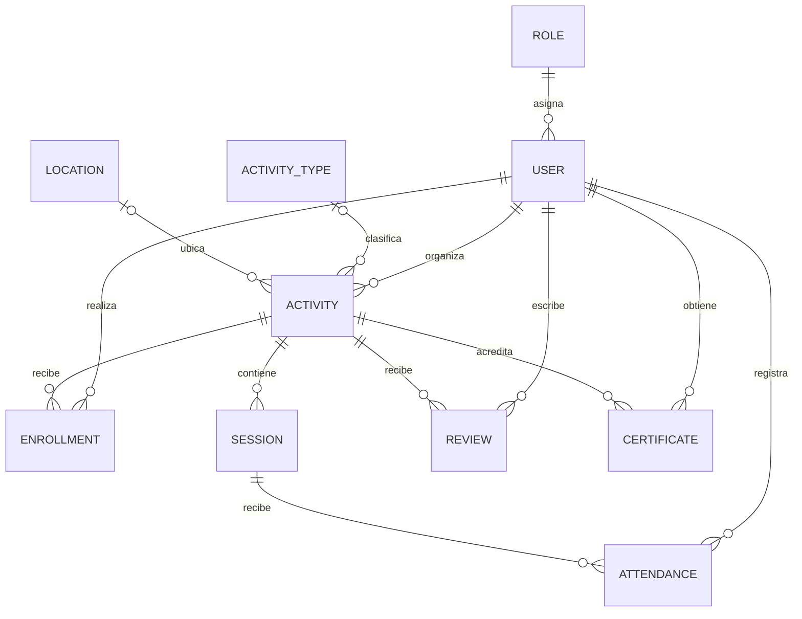

# Arquitectura de Kooler

## 6.1 Diagrama de arquitectura

El frontend Next.js presenta la interfaz web y consume la API REST de NestJS. NestJS aplica las reglas de negocio y usa TypeORM para persistir la información en PostgreSQL. Docker Compose define los servicios `backend` y `postgres`.

### Modelo de datos relevante para las funcionalidades

`SESSION` pertenece a una actividad. `ATTENDANCE` relaciona a un usuario con una sesión y tiene unicidad por `(id_user, id_session)`. `CERTIFICATE` relaciona a un usuario con una actividad y es único por `(id_user, id_activity)`.

## 6.2 Stack tecnológico

* **Frontend:** Next.js y React, con rutas App Router y estilos Tailwind CSS.
* **Backend:** NestJS con API REST.
* **Persistencia:** PostgreSQL mediante TypeORM.
* **Autenticación y autorización:** JWT, Passport y guards de roles.
* **Ejecución de servicios:** Docker Compose.

## 6.3 Módulos implementados del backend

Los siguientes módulos están registrados en `AppModule`:

* **AuthModule:** registro, inicio de sesión y perfil autenticado.
* **UsersModule:** servicios de usuarios utilizados por los demás módulos.
* **ActivitiesModule:** actividades, inscripciones y sesiones; incluye la finalización programada de actividades.
* **CatalogModule:** lectura de tipos de actividad y ubicaciones.
* **AttendanceModule:** registro y consulta de asistencia por sesión.
* **CertificatesModule:** consulta de elegibilidad, emisión y descarga de certificados PDF.
* **ReviewsModule:** creación y consulta de reseñas.
* **HistoryModule:** historial de actividades del estudiante.
* **HealthModule:** comprobación de salud de la API.
* **SeedModule:** creación de roles y usuarios de demostración al iniciar la aplicación.

La configuración de TypeORM se realiza en `AppModule`. Los guards JWT y de roles y el interceptor de logging son componentes compartidos, no módulos funcionales independientes.

## 6.4 Rutas principales

### Frontend

Las rutas siguientes corresponden a páginas presentes en `frontend/src/app`:

* `/` — bienvenida.
* `/login`, `/register` y `/account-created` — flujo visual de autenticación.
* `/home`, `/my-enrollments`, `/progress` y `/history` — vistas del estudiante.
* `/activities/[id]` — detalle de actividad.
* `/organizer/activities` y `/organizer/activities/new` — panel y creación de actividades.
* `/organizer/activities/[id]`, `/organizer/activities/[id]/attendance` y `/organizer/activities/[id]/feedback` — detalle, asistencia y retroalimentación del organizador.

El frontend utiliza actualmente datos locales en `frontend/src/lib/mock.ts` y todavía no consume la API.

### API

La aplicación añade el prefijo global `/api`. Entre sus rutas implementadas están:

* `/api/auth/register`, `/api/auth/login` y `/api/auth/profile` — registro, login y perfil.
* `/api/activities`, `/api/activities/:id`, `/api/activities/my-enrollments`, `/api/activities/:id/enroll`, `/api/activities/:id/enrollments` y `/api/activities/:id/sessions` — actividades, inscripciones y sesiones.
* `/api/activity-types` y `/api/locations` — catálogos públicos.
* `/api/activities/:activityId/sessions/:sessionId/attendance` — consulta y registro de asistencia por sesión.
* `/api/certificates`, `/api/certificates/activities/:activityId/eligibility` y `/api/certificates/:certificateId/download` — certificados, elegibilidad y descarga.
* `/api/reviews` y `/api/reviews/activity/:activityId` — creación y consulta de reseñas; `/api/reviews/organizer/activity/:activityId` — retroalimentación del organizador.
* `/api/history` — historial del estudiante.
* `/api/health` — estado de la API.

## 6.5 Persistencia y ejecución

TypeORM registra las entidades de los módulos y se conecta a PostgreSQL mediante las variables `DB_HOST`, `DB_PORT`, `DB_USERNAME`, `DB_PASSWORD` y `DB_DATABASE`. `backend/compose.yaml` define PostgreSQL y el backend; dentro de Compose, el backend usa el servicio `postgres` como host de base de datos.
