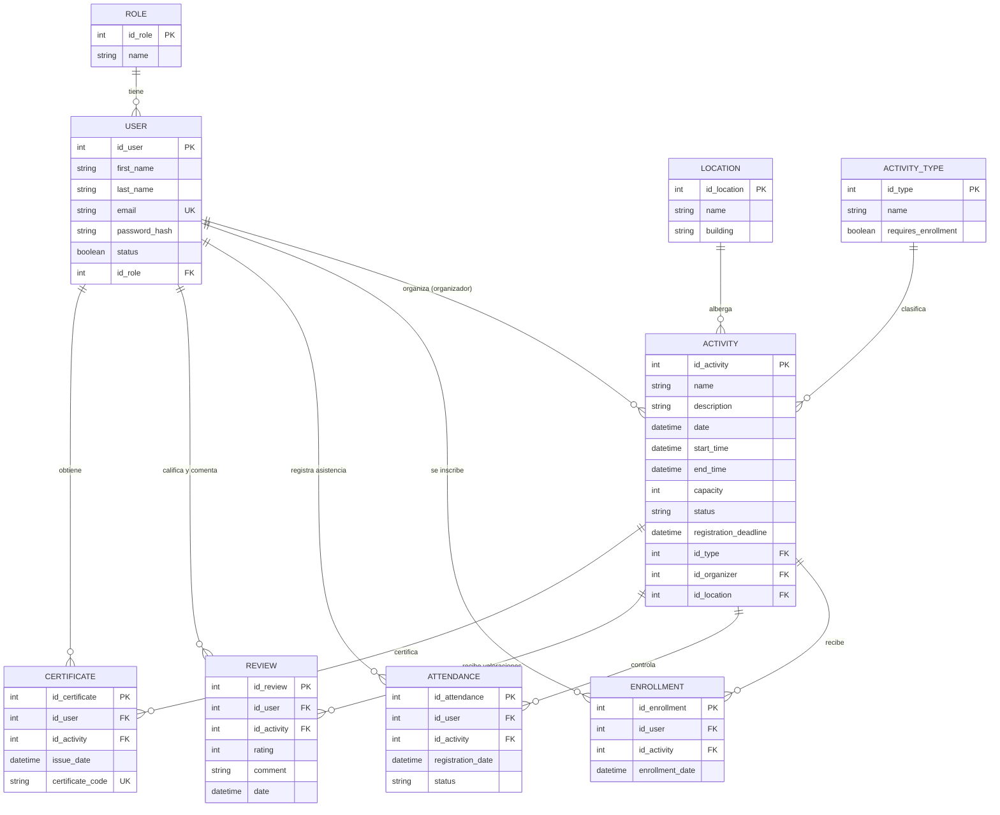

# 🗄️ Diseño de Base de Datos — Kooler

## Objetivo del modelo
El modelo de base de datos define cómo se almacenará y relacionará la información necesaria para gestionar las actividades de Bienestar Universitario. Se contemplan los usuarios y sus roles, las actividades, las ubicaciones, las categorías, las inscripciones, la asistencia, las valoraciones y la certificación, permitiendo soportar las 3 funcionalidades principales del sistema.

---

## 4.1 Diagrama Entidad-Relación (ERD)

El modelo está compuesto por **nueve entidades principales**: `ROLE`, `USER`, `ACTIVITY`, `ACTIVITY_TYPE`, `LOCATION`, `ENROLLMENT`, `ATTENDANCE`, `REVIEW` y `CERTIFICATE`.

---

## 4.2 Entidades, Claves y Relaciones

### Claves Primarias (PK):
* `ROLE.id_role`
* `USER.id_user`
* `LOCATION.id_location`
* `ACTIVITY_TYPE.id_type`
* `ACTIVITY.id_activity`
* `ENROLLMENT.id_enrollment`
* `ATTENDANCE.id_attendance`
* `REVIEW.id_review`
* `CERTIFICATE.id_certificate`

### Claves Foráneas (FK):
* `USER.id_role` ➔ `ROLE.id_role`
* `ACTIVITY.id_organizer` ➔ `USER.id_user`
* `ACTIVITY.id_type` ➔ `ACTIVITY_TYPE.id_type`
* `ACTIVITY.id_location` ➔ `LOCATION.id_location`
* `ENROLLMENT.id_user` ➔ `USER.id_user`
* `ENROLLMENT.id_activity` ➔ `ACTIVITY.id_activity`
* `ATTENDANCE.id_user` ➔ `USER.id_user`
* `ATTENDANCE.id_activity` ➔ `ACTIVITY.id_activity`
* `REVIEW.id_user` ➔ `USER.id_user`
* `REVIEW.id_activity` ➔ `ACTIVITY.id_activity`
* `CERTIFICATE.id_user` ➔ `USER.id_user`
* `CERTIFICATE.id_activity` ➔ `ACTIVITY.id_activity`

### Claves Únicas (UK):
* `USER.email`
* `CERTIFICATE.certificate_code`

---

## 4.3 Restricciones de Negocio Relevantes

1. **Inscripciones no duplicadas:** Un estudiante no puede inscribirse dos veces en la misma actividad (`UNIQUE(id_user, id_activity)` en `ENROLLMENT`).
2. **Capacidad máxima:** El número de inscritos no puede superar el campo `capacity` establecido para la actividad.
3. **Estado de actividad para inscripción:** Solo las actividades en estado `ACTIVE` permiten nuevas inscripciones.
4. **Fecha límite de inscripción:** No se permiten inscripciones después de `registration_deadline`.
5. **Asistencia única:** Un usuario no puede registrar asistencia más de una vez para la misma actividad (`UNIQUE(id_user, id_activity)` en `ATTENDANCE`).
6. **Certificado único:** Un estudiante solo puede tener un certificado por actividad.
7. **Emisión de certificados:** Solo se genera certificado cuando la actividad ha finalizado (`FINISHED`) y el estudiante cumple con la asistencia requerida. Cada certificado tiene un código único generado automáticamente (`certificate_code`).
8. **Estados de actividad permitidos:** `ACTIVE`, `CANCELLED`, `FINISHED`.
9. **Propiedad de recursos:** Un organizador solo puede modificar o cancelar las actividades que él mismo creó (`id_organizer == user.id`).
10. ⚠️ **Retroalimentación oficial D1 sobre Reseñas y Comentarios:**
    * **Visibilidad pública:** Las valoraciones y comentarios de `REVIEW` son **visibles para cualquier estudiante** en el detalle de la actividad (no son privados del organizador).
    * **Inmutabilidad por el organizador:** El organizador tiene vista de solo lectura del promedio y los comentarios; **NO puede editarlos ni eliminarlos**.
    * **Requisito para calificar:** Solo puede calificar una vez un estudiante que **haya participado (asistencia confirmada)** en una actividad en estado `FINISHED`.

---

## 4.4 Diccionario de Datos Oficial (Data Dictionary)

### 1. Entidad: `ROLE`
| Campo | Tipo | Clave | Descripción |
| :--- | :--- | :--- | :--- |
| `id_role` | `int` | **PK** | Identificador único del rol. |
| `name` | `string` | | Nombre del rol (ej: `ESTUDIANTE`, `ORGANIZADOR`). |

### 2. Entidad: `USER`
| Campo | Tipo | Clave | Descripción |
| :--- | :--- | :--- | :--- |
| `id_user` | `int` | **PK** | Identificador único del usuario. |
| `first_name` | `string` | | Primer nombre del usuario. |
| `last_name` | `string` | | Apellidos del usuario. |
| `email` | `string` | **UK** | Correo institucional único del usuario. |
| `password_hash` | `string` | | Contraseña encriptada con algoritmo seguro (bcrypt). |
| `status` | `boolean / string` | | Estado de la cuenta (activo/inactivo). |
| `id_role` | `int` | **FK** | Rol asociado al usuario (`ROLE.id_role`). |

### 3. Entidad: `LOCATION`
| Campo | Tipo | Clave | Descripción |
| :--- | :--- | :--- | :--- |
| `id_location` | `int` | **PK** | Identificador único de la ubicación. |
| `name` | `string` | | Nombre del espacio (ej: Auditorio Varela, Cancha 1). |
| `building` | `string` | | Edificio o zona donde se encuentra el espacio. |

### 4. Entidad: `ACTIVITY_TYPE`
| Campo | Tipo | Clave | Descripción |
| :--- | :--- | :--- | :--- |
| `id_type` | `int` | **PK** | Identificador único del tipo o categoría de actividad. |
| `name` | `string` | | Nombre de la categoría (ej: Deportes, Salud Mental, Arte). |
| `requires_enrollment`| `boolean` | | Indica si la actividad requiere inscripción previa. |

### 5. Entidad: `ACTIVITY`
| Campo | Tipo | Clave | Descripción |
| :--- | :--- | :--- | :--- |
| `id_activity` | `int` | **PK** | Identificador único de la actividad. |
| `name` | `string` | | Título o nombre de la actividad. |
| `description` | `string` | | Descripción detallada de la actividad. |
| `date` | `datetime` | | Fecha de realización de la actividad. |
| `start_time` | `datetime / string`| | Hora de inicio. |
| `end_time` | `datetime / string`| | Hora de finalización. |
| `capacity` | `int` | | Número máximo de cupos disponibles. |
| `status` | `string` | | Estado: `ACTIVE`, `CANCELLED`, `FINISHED`. |
| `registration_deadline` | `datetime` | | Fecha y hora límite para inscribirse. |
| `id_type` | `int` | **FK** | Tipo o categoría de la actividad (`ACTIVITY_TYPE.id_type`). |
| `id_organizer` | `int` | **FK** | Organizador responsable (`USER.id_user`). |
| `id_location` | `int` | **FK** | Lugar de realización (`LOCATION.id_location`). |

### 6. Entidad: `ENROLLMENT`
| Campo | Tipo | Clave | Descripción |
| :--- | :--- | :--- | :--- |
| `id_enrollment` | `int` | **PK** | Identificador único de la inscripción. |
| `id_user` | `int` | **FK** | Estudiante inscrito (`USER.id_user`). |
| `id_activity` | `int` | **FK** | Actividad a la que se inscribe (`ACTIVITY.id_activity`). |
| `enrollment_date` | `datetime` | | Fecha y hora exacta de la inscripción. |

### 7. Entidad: `ATTENDANCE`
| Campo | Tipo | Clave | Descripción |
| :--- | :--- | :--- | :--- |
| `id_attendance` | `int` | **PK** | Identificador único del registro de asistencia. |
| `id_user` | `int` | **FK** | Usuario asistente (`USER.id_user`). |
| `id_activity` | `int` | **FK** | Actividad asistida (`ACTIVITY.id_activity`). |
| `registration_date` | `datetime` | | Fecha y hora en que se registró la asistencia. |
| `status` | `string` | | Estado de asistencia (ej: `PRESENT`, `ABSENT`). |

### 8. Entidad: `REVIEW` *(Actualizada con retroalimentación D1)*
| Campo | Tipo | Clave | Descripción |
| :--- | :--- | :--- | :--- |
| `id_review` | `int` | **PK** | Identificador único de la valoración. |
| `id_user` | `int` | **FK** | Estudiante que escribe la reseña (`USER.id_user`). |
| `id_activity` | `int` | **FK** | Actividad valorada (`ACTIVITY.id_activity`). |
| `rating` | `int` | | Calificación numérica de 1 a 5 estrellas. |
| `comment` | `string` | | Texto con la opinión pública del estudiante. |
| `date` | `datetime` | | Fecha y hora en que se emitió la valoración. |

> 📢 **Regla de visualización y permisos:** Esta entidad es visible públicamente para cualquier estudiante que consulte la actividad. Los organizadores pueden consultar el promedio y leer los comentarios, pero **no tienen permisos para modificarlos ni borrarlos**.

### 9. Entidad: `CERTIFICATE`
| Campo | Tipo | Clave | Descripción |
| :--- | :--- | :--- | :--- |
| `id_certificate` | `int` | **PK** | Identificador único del certificado. |
| `id_user` | `int` | **FK** | Estudiante certificado (`USER.id_user`). |
| `id_activity` | `int` | **FK** | Actividad certificada (`ACTIVITY.id_activity`). |
| `issue_date` | `datetime` | | Fecha de emisión del certificado. |
| `certificate_code` | `string` | **UK** | Código hash/alfanumérico único verificable. |

---

## 4.5 Soporte de las Funcionalidades Principales
1. **Funcionalidad 1 (Gestión y Participación):** Soportada por `ACTIVITY`, `ACTIVITY_TYPE`, `LOCATION` y `ENROLLMENT`. Permite al organizador crear actividades y a los estudiantes consultar cupos e inscribirse con control de concurrencia.
2. **Funcionalidad 2 (Historial, Valoración y Comentarios Públicos):** Soportada por `REVIEW`. Permite a los estudiantes que asistieron calificar del 1 al 5 y dejar comentarios visibles para toda la comunidad universitaria tras finalizar el evento.
3. **Funcionalidad 3 (Certificación por Asistencia):** Soportada por `ATTENDANCE` y `CERTIFICATE`. Calcula si el estudiante cumplió con la asistencia requerida y emite un certificado con código único verificable.
